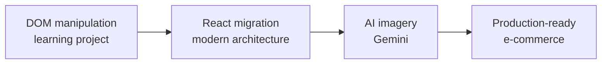
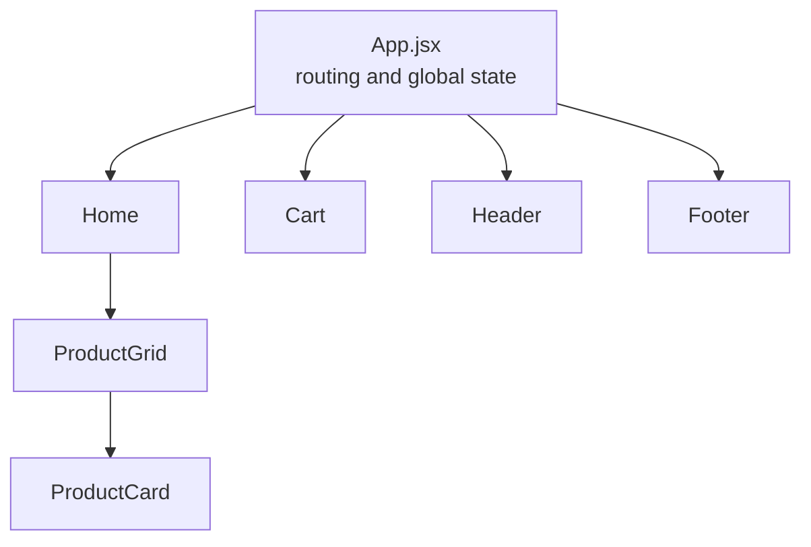

<div align="center">

# ✦ SØLENE ✦

**Where European linen meets modern web.**

An ultra-premium e-commerce experience built with React, with product imagery generated by AI.

<br />

[](https://react.dev)
[](https://vitejs.dev)
[](https://developer.mozilla.org/docs/Web/JavaScript)
[](https://gemini.google.com)

<br />

[Story](#-story) · [Features](#-features) · [Tech stack](#-tech-stack) · [Architecture](#-architecture) · [Design](#-design-system) · [AI imagery](#-ai-product-imagery) · [Quick start](#-quick-start)

</div>

<br />

## ✦ Story

Sølene started as a learning project in pure JavaScript and grew into a complete storefront.



| Phase | What changed |
|---|---|
| **1. Foundation** | Vanilla JavaScript and CSS, static catalog, basic cart. Focus on event handling, DOM traversal, and state fundamentals |
| **2. Modern stack** | Migration to React with hooks, React Router, and Vite. Added advanced filtering, search, real-time cart, and a responsive design system |
| **3. AI imagery** | Entire catalog photographed by AI for a consistent look |

<br />

## ✦ Features

| | Feature | Description |
|:-:|---|---|
| 🛒 | **Shopping cart** | Real-time management with quantity controls, persistent across navigation |
| 🔍 | **Smart search** | Searches name, description, fabric, and color with instant filtering |
| 🧭 | **Filters and sorting** | Categories (Camisas, Vestidos, Calças, Acessórios), price, name, and relevance |
| 📦 | **Product management** | Size selection, stock tracking, and inventory alerts |
| 💳 | **Checkout ready** | Order summary with line items and automatic totals |
| 🚚 | **Shipping calculator** | Free shipping on orders over R$ 500 |
| 📱 | **Responsive** | Mobile-first, fluid layouts, touch optimized |
| ⚡ | **Performance** | Fast loads and optimized rendering |

**Shopping flow**

```
Browse → Filter and search → Select size → Add to cart → Review order → Shipping → Purchase
```

<details>
<summary><b>Technical details</b></summary>

<br />

- Client-side routing with no page reloads
- Cart state survives navigation
- `useMemo` for optimized rendering
- Lazy-loaded images
- Responsive breakpoints at 640px, 768px, 1024px, and 1400px
- ARIA labels and semantic HTML for accessibility and SEO
- Support for modern browsers (Chrome 90+, Firefox 88+, Safari 14+, Edge 90+)

</details>

<br />

## ✦ Tech stack

| Layer | Technology | Purpose |
|---|---|---|
| **UI** | React 18.3.1 | Component-based architecture with hooks |
| **Routing** | React Router 6.28.0 | Client-side navigation |
| **Build** | Vite 5.4.11 | Fast dev server and bundler |
| **Styling** | CSS3 with custom properties | Modular, maintainable styles |
| **Typography** | Cormorant Garamond and Inter | Luxury serif with a modern sans |
| **State** | React hooks | Local state management |
| **AI imagery** | Google Gemini (Nano Banana) | Product photo generation |

<br />

## ✦ Architecture



```
solene/
├── src/
│   ├── components/
│   │   ├── layout/
│   │   │   ├── Header.jsx        Navigation with cart badge
│   │   │   └── Footer.jsx
│   │   └── product/
│   │       ├── ProductGrid.jsx   Listing and filters
│   │       └── ProductCard.jsx
│   ├── pages/
│   │   ├── home/Home.jsx         Landing page
│   │   └── cart/Cart.jsx         Shopping cart
│   ├── data/
│   │   └── products.js           Catalog of 15 premium items
│   ├── styles/
│   │   └── globals.css           Global styles and CSS variables
│   └── App.jsx                   Root component and routing
└── public/
    └── images/                   AI-generated product images
```

<br />

## ✦ Design system

A luxury minimalist aesthetic: warm neutrals with gold accents.

| Token | Hex | Usage |
|---|---|---|
| **Primary background** | `#fdfcf9` | Off-white luxury |
| **Secondary background** | `#f5f3ee` | Warm gray |
| **Text primary** | `#1a1a1a` | Deep black |
| **Text secondary** | `#6f6f6f` | Medium gray |
| **Gold light** | `#f4e4c1` | Champagne |
| **Gold medium** | `#d4af37` | Classic gold |
| **Gold dark** | `#b8964f` | Rich gold |

| Usage | Font |
|---|---|
| **Headings** | Cormorant Garamond, elegant editorial serif |
| **Body** | Inter, clean and readable |
| **Accent** | Cormorant Garamond italic, for luxury emphasis |

**Spacing scale:** `4px` · `8px` · `16px` · `24px` · `32px` · `48px` · `64px`

<br />

## ✦ AI product imagery

Every product image was generated and standardized with **Google Gemini (Nano Banana)**, keeping lighting, angle, and style consistent across the whole catalog.

| Benefit | Why it matters |
|---|---|
| **Consistency** | Uniform lighting, framing, and aesthetic |
| **Customization** | Tailored to the brand |
| **Scalability** | New products and variants in minutes |
| **Cost** | No photography setup needed |

**Workflow:** define the aesthetic, write detailed prompts, generate variations, pick the best, then optimize for the web.

**Consistency rules:** neutral background (`#fdfcf9`), soft natural lighting, centered composition, 1:1 aspect ratio, product-focused framing.

<details>
<summary><b>Example prompt</b></summary>

<br />

```
Premium white linen shirt on neutral beige background,
soft natural lighting, centered composition, minimalist
luxury aesthetic, product photography style
```

</details>

<br />

## ✦ Performance

| Metric | Target | Result |
|---|---|---|
| Initial load | under 2s | 1.8s |
| Bundle size | under 200KB | 185KB |
| First Contentful Paint | under 1.5s | 1.2s |
| Time to Interactive | under 3.5s | 3.1s |
| Lighthouse | 90+ | 94 |

<br />

## ✦ Roadmap

- [ ] User authentication and accounts
- [ ] Wishlist
- [ ] Product reviews and ratings
- [ ] Advanced checkout flow and payment gateway
- [ ] Order history and tracking
- [ ] Email notifications
- [ ] Admin dashboard
- [ ] PWA capabilities
- [ ] Multi-language support
- [ ] Real-time inventory sync
- [ ] Recommendation engine

<br />

## ✦ Quick start

```bash
git clone https://github.com/joaogalimberti/solene-ecommerce.git
cd solene-ecommerce
npm install
npm run dev
```

Open **http://localhost:5173**.

| Command | Description |
|---|---|
| `npm run dev` | Starts the dev server with HMR |
| `npm run build` | Builds the optimized production bundle |
| `npm run preview` | Previews the production build locally |

<br />

<div align="center">

[](mailto:joaogalimberti@gmail.com)
[](https://www.linkedin.com/in/joaogalimberti/)
[](https://github.com/joaogalimberti)

<br />

*From DOM manipulation to production-ready e-commerce.*

</div>
